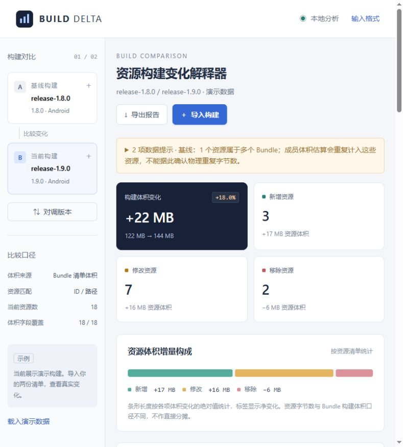

# Resource Build Change Explainer

[简体中文](README.md) | [English](README.en.md)

Compare two resource build manifests and explain additions, removals, byte-size changes, content-hash changes, Bundle membership, and dependency changes. The project provides a local web interface and a command-line tool, with no third-party dependencies to install. All included examples are demonstration data.



The documentation is available in Chinese and English. The web interface, CLI messages, Markdown reports, and human-readable explanations in JSON results currently use Chinese; structured JSON field names use English.

## Quick start

Use an existing **Node.js 20 or later** installation. On Windows, double-click `start.cmd`, or run the following command from the project directory:

```powershell
npm start
```

Open [http://127.0.0.1:4173](http://127.0.0.1:4173). The page initially shows a demonstration comparison. Click **导入构建** (Import builds) to select or paste the baseline and current JSON/CSV manifests. Manifest contents are parsed in the browser and are not sent to the server. To choose a different port in PowerShell, set `$env:PORT=4180` before starting the server.

No `npm install` is required. The server listens only on the local address `127.0.0.1`; stop it with `Ctrl+C`. On macOS/Linux, use `npm start`, or `PORT=4180 npm start` to change the port. `start.cmd` is for Windows only.

## Features

- Match resources by their identity: use `id` when supplied, otherwise use the normalized path. Classify records as added, modified, removed, or unchanged.
- Compare byte size, hash, type, path, Bundle membership, and dependency lists.
- Use complete explicit Bundle sizes for the build total; otherwise use resource-size totals and show the measurement basis.
- Show the largest resource-size increases, multiple-Bundle membership, stable hashes with changing sizes, and possible dependency propagation.
- Inspect evidence and potential reverse-dependency impact for individual resources. Search, filter, sort, and page through records.
- Export a Markdown review report or structured JSON, and use the CLI in CI workflows.

## Manifest format

```json
{
  "name": "release-1.2",
  "version": "1.2",
  "platform": "Android",
  "assets": [
    {
      "id": "optional-stable-guid",
      "path": "Assets/Textures/hero.png",
      "size": 1048576,
      "hash": "content-hash",
      "bundle": "characters",
      "dependencies": ["Assets/Materials/hero.mat"],
      "type": "Texture"
    }
  ],
  "bundles": [{ "name": "characters", "size": 800000, "hash": "bundle-hash" }]
}
```

The top-level `assets` array and each resource's `path` are required. Other fields are optional. Missing sizes are marked unknown. `size` always uses bytes; `byteSize` and `sizeBytes` are supported aliases. Use resource-level `bundles: ["a", "b"]` for multiple Bundle memberships. Dependencies may reference resource paths or IDs. A top-level resource array is also accepted.

Resource-level `bundles` describes membership, while top-level `bundles` contains Bundle output records. Each Bundle record requires `name`; `size` and `hash` are optional. The total uses Bundle sizes only when every recognized Bundle has an explicit, known size. Ensure the manifest covers all outputs you intend to compare.

Keep the use of `id` consistent between manifests. If the same path has a separate ID in one manifest and none in the other, it appears as removal and addition: there is no fallback to path matching. A stable ID with a changed path is recognized as a rename.

CSV headers must include `path`; typical headers are `path,size,hash,bundle,dependencies,type`. Separate multiple Bundle names or dependencies with semicolons. Quote fields containing commas or line breaks, and write embedded double quotes as `""`. See [examples/resources.csv](examples/resources.csv).

Import rejects duplicate resource IDs or paths, duplicate Bundle names, and negative or non-finite sizes. Paths use forward slashes, repeated slashes collapse, leading `./` segments are removed, and case is preserved. Each browser file or pasted input is limited to **20 × 1024² bytes**. The CLI has no such fixed limit; input size is constrained by available memory.

## Command line

```powershell
node cli.mjs --before examples/baseline.json --after examples/current.json --out reports.md
node cli.mjs --before examples/baseline.json --after examples/current.json --format json --out result.json
```

Without `--out`, the report goes to standard output. `--format` defaults to `md`; argument or parsing errors exit with code `1`. The analysis does not read resource paths or dependency targets recorded inside the manifests.

`--out` writes the specified path; its parent directory must exist, and an existing output file is overwritten. `--help` or `-h` displays usage. JSON results contain `before`, `after`, `summary`, `changes`, `bundles`, `insights`, and `warnings` for subsequent CI processing. Detecting resource changes alone does not produce a failure exit code: apply your own size or count thresholds.

The included demonstration pair should produce a Bundle total of **127,926,272 → 150,994,944 bytes**, an increase of **23,068,672 bytes** (displayed as `+22 MB`), with **3 added, 2 removed, 7 modified, and 8 unchanged** resources. Displayed `KB`, `MB`, and larger units use powers of 1024.

## Interpretation and limitations

“Confirmed” means a fact observed in the input manifests. “Possible” means a relationship that requires build logs to verify. Dependency impact follows the union of the before and after dependency graphs and does not establish actual rebuilds. Each impact list shows at most the first 30 resources sorted by ID. Unresolved dependencies and self-references are excluded from graph traversal.

Compressed Bundle sizes cannot be allocated directly to individual resource byte sizes. Multiple-Bundle membership alone does not prove physical duplication or downloadable savings. Missing hashes prevent confirmation of content changes. A stable hash with a changed size may result from different settings, measurement bases, or digest semantics, and does not by itself establish identical contents.

Total deltas and growth rates are suppressed when both manifests specify different `platform` values, when the measurement basis differs, or when the totals are incomplete. A missing platform produces a warning but does not itself suppress comparison. A zero baseline does not produce an infinite growth percentage. Keep build settings and field definitions consistent between manifests.

This is a general-purpose manifest explainer. Native Unity Addressables Build Layout reports, Unreal cook logs, and other engine-specific formats need conversion by your build exporter. The application does not directly ingest those native formats, detect compression algorithms, or calculate incremental download sizes.

## Project structure

| Path | Purpose |
| --- | --- |
| `public/` | Local web interface and styles |
| `lib/importers.mjs` | JSON/CSV parsing and input validation |
| `lib/analyzer.mjs` | Comparison, dependency analysis, and Markdown reporting |
| `cli.mjs` | Command-line entry point |
| `server.mjs`, `start.cmd` | Local server and Windows launcher |
| `examples/` | Demonstration JSON/CSV manifests |
| `tests/` | Analyzer and CLI tests |
| `artifacts/preview.jpg` | Screenshot of the demonstration interface |

`reports/`, example output files, and local dependency directories are ignored by Git and are not included in the repository.

## Verification

```powershell
npm test
```

Tests cover invalid imports, CSV quoting, different kinds of changes, Bundle totals, missing fields, measurement-basis differences, stable-ID renames, dependency cycles, and report output.

This project reuses an existing Node.js installation and does not install shared tools. Any future shared developer tools should follow the project convention and be installed under `D:\Program Files\ToolName\Version`.
